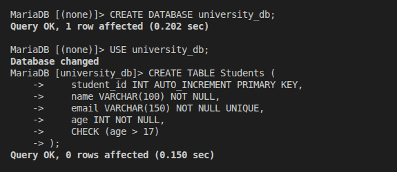
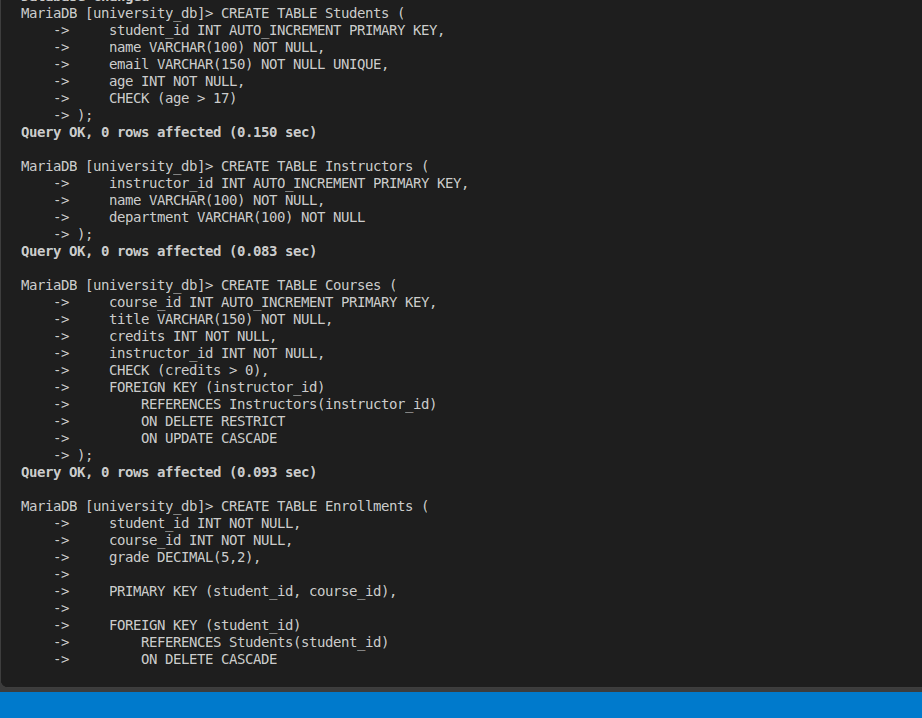
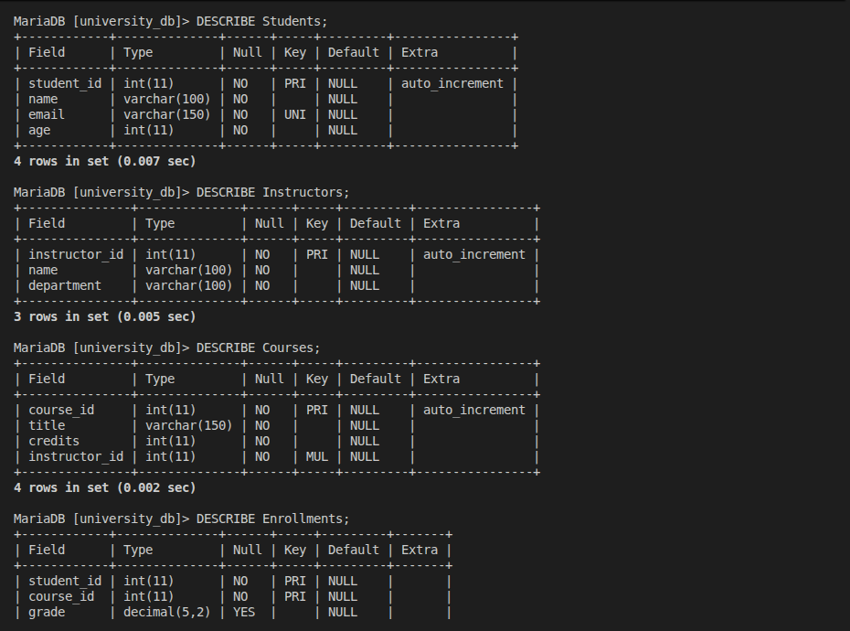
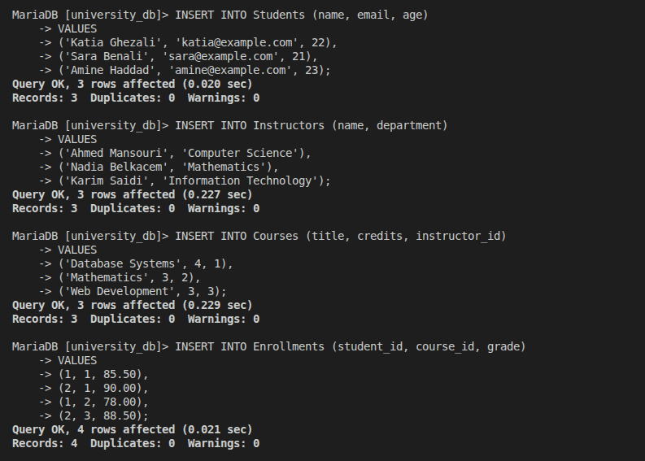
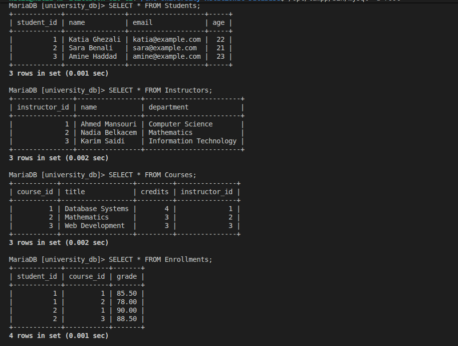
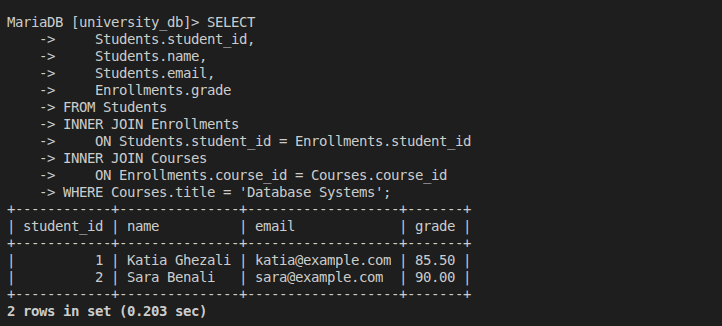
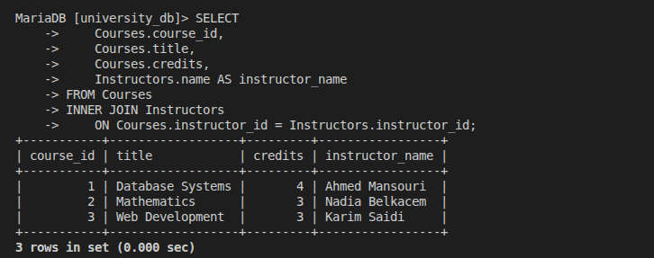
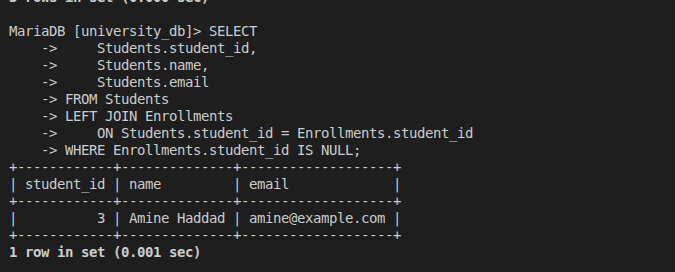
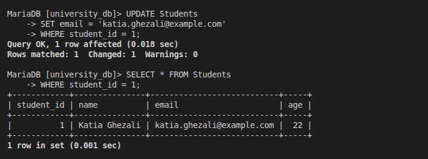
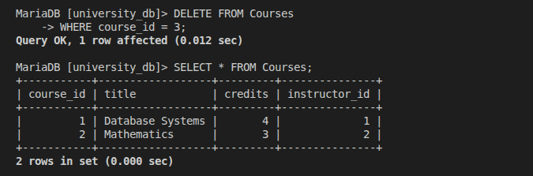

# GMC University Relational Database

A relational database project that simulates a university information system. It manages students, instructors, courses, and enrollments using SQL and MariaDB.

## Technologies Used

- SQL
- MariaDB
- XAMPP

## How to Run

The SQL scripts are included to document the database implementation and allow the project to be reproduced.

Execute the SQL files in the following order:

1. `01_create_database.sql`
2. `02_create_tables.sql`
3. `03_insert_sample_data.sql`
4. `04_queries.sql`

The project was developed and tested using MariaDB through XAMPP.

## Step 1 – Database Schema Design

The university database is designed using a relational model consisting of four tables: `Students`, `Instructors`, `Courses`, and `Enrollments`.

### 1.1 Tables and Attributes

**Students**

Stores information about university students.

| Attribute  | Data Type    | Description               |
| ---------- | ------------ | ------------------------- |
| student_id | INT          | Unique student identifier |
| name       | VARCHAR(100) | Student's name            |
| email      | VARCHAR(150) | Student's email address   |
| age        | INT          | Student's age             |

**Instructors**

Stores information about instructors.

| Attribute     | Data Type    | Description                  |
| ------------- | ------------ | ---------------------------- |
| instructor_id | INT          | Unique instructor identifier |
| name          | VARCHAR(100) | Instructor's name            |
| department    | VARCHAR(100) | Instructor's department      |

**Courses**

Stores information about courses and their assigned instructors.

| Attribute     | Data Type    | Description                    |
| ------------- | ------------ | ------------------------------ |
| course_id     | INT          | Unique course identifier       |
| title         | VARCHAR(150) | Course title                   |
| credits       | INT          | Number of course credits       |
| instructor_id | INT          | Instructor teaching the course |

**Enrollments**

Connects students to the courses they take and stores their grades.

| Attribute  | Data Type    | Description                   |
| ---------- | ------------ | ----------------------------- |
| student_id | INT          | Enrolled student's identifier |
| course_id  | INT          | Course identifier             |
| grade      | DECIMAL(5,2) | Student's grade               |

### 1.2 Relationships Between Tables

- **Instructors and Courses (One-to-Many):** One instructor can teach multiple courses, while each course is assigned to one instructor.
- **Students and Enrollments (One-to-Many):** One student can have multiple enrollment records.
- **Courses and Enrollments (One-to-Many):** One course can have multiple enrollment records.

Students and Courses have a many-to-many relationship because students can enroll in multiple courses, and each course can have multiple students. The `Enrollments` table resolves this relationship.

### 1.3 Primary Keys and Foreign Keys

| Table       | Primary Key           | Foreign Key                                                                         |
| ----------- | --------------------- | ----------------------------------------------------------------------------------- |
| Students    | student_id            | None                                                                                |
| Instructors | instructor_id         | None                                                                                |
| Courses     | course_id             | instructor_id references Instructors(instructor_id)                                 |
| Enrollments | student_id, course_id | student_id references Students(student_id); course_id references Courses(course_id) |

The `Enrollments` table uses a composite primary key consisting of `student_id` and `course_id`. This prevents a student from enrolling in the same course more than once.

### 1.4 Database Normalization

The database follows normalization principles up to Third Normal Form (3NF).

**First Normal Form (1NF)**

Each column contains atomic values. Multiple courses are not stored in a single student record; instead, each enrollment is stored as a separate record in the `Enrollments` table.

**Second Normal Form (2NF)**

Every non-key attribute depends on the entire primary key. In the `Enrollments` table, the grade depends on both `student_id` and `course_id`, which form the composite primary key.

**Third Normal Form (3NF)**

Non-key attributes depend only on the primary key, avoiding transitive dependencies. Instructor information is stored separately in the `Instructors` table, while `Courses` references instructors through `instructor_id`. This avoids repeating instructor details across courses.

### 1.5 Constraints

| Constraint                          | Applied To              | Purpose                                |
| ----------------------------------- | ----------------------- | -------------------------------------- |
| PRIMARY KEY                         | All tables              | Uniquely identifies each record        |
| FOREIGN KEY                         | Courses and Enrollments | Maintains relationships between tables |
| NOT NULL                            | Required attributes     | Prevents missing required values       |
| UNIQUE                              | Students.email          | Prevents duplicate student emails      |
| CHECK (age > 17)                    | Students.age            | Ensures students are older than 17     |
| CHECK (credits > 0)                 | Courses.credits         | Ensures positive course credits        |
| CHECK (grade >= 0 AND grade <= 100) | Enrollments.grade       | Restricts grades to the range 0–100    |

These constraints maintain the accuracy, consistency, and integrity of the database.

## Step 2 – SQL Table Creation

The database contains four relational tables:

- `Students`
- `Instructors`
- `Courses`
- `Enrollments`

Primary keys, foreign keys, and constraints are defined in the table creation statements.

The SQL implementation is available in `sql/02_create_tables.sql`.

## Step 3 – Insert Sample Data

Sample records were inserted into all four tables to demonstrate the database relationships.

The database contains:

- 3 students
- 3 instructors
- 3 courses
- 4 enrollment records

The insertion statements are available in `sql/03_insert_sample_data.sql`.

## Step 4 – Query Execution

The following SQL operations were implemented and tested:

1. Retrieve all students enrolled in **Database Systems**.
2. List all courses along with the names of their instructors.
3. Find students who are not enrolled in any course.
4. Update the email address of a student.
5. Delete a course by its ID, removing its associated enrollment records first.

The SQL queries are available in `sql/04_queries.sql`.

## Testing

All database operations and SQL queries were executed and tested using **MariaDB through XAMPP**.

The following screenshots demonstrate database creation, table structure, sample data, and the five required SQL operations.

### 1. Database Creation

### 2. Table Creation

### 3. Table Structure

### 4. Sample Data Insertion

### 5. Database Records

### 6. Retrieve Students Enrolled in Database Systems

### 7. List Courses with Their Instructors

### 8. Find Students Not Enrolled in Any Course

### 9. Update a Student's Email

### 10. Delete a Course by ID

